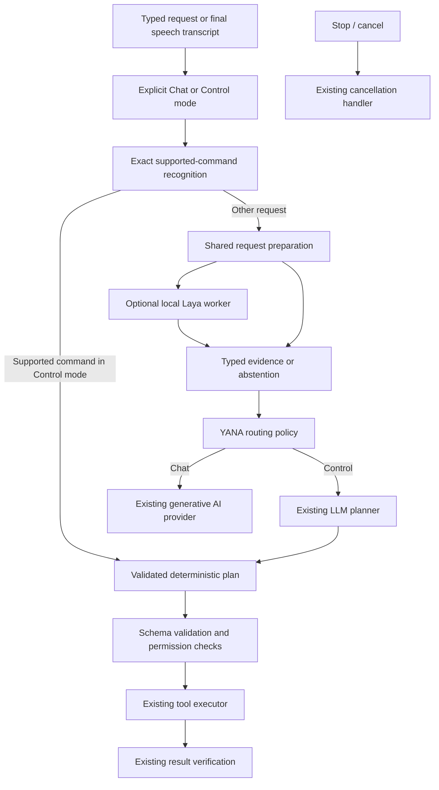

# Implementation plan: Laya decision layer for YANA

Prepared 19 October 2026. Scope: analysis and proposed implementation; no application behavior or dependencies changed.

## Recommendation

Integrate Laya as an **optional local decision service** beside YANA's existing AI providers. Use it first to evaluate request complexity and recommend a provider tier, then to narrow tool candidates if measurements justify that extra work. Keep YANA's explicit Chat / Control my PC modes, deterministic command parser, LLM planner, permissions, execution and verification authoritative.

The project already contains a partial Laya integration. Completing its lifecycle, failure semantics, calibration and Windows packaging is more important than adding more classifications. Do not simply enable the current flag or upgrade the package in place.

The minimum useful release is: one pinned checkpoint, isolated worker, truthful health/status, a shared decision contract, shadow evaluation, and a narrowly enabled routing policy. Tool shortlisting, memory relevance and multilingual expansion are later modules. Laya does not supply chat responses, arbitrary tool arguments, screen understanding, speech recognition or desktop automation.

## Evidence and boundaries of this analysis

- YANA inspected at commit `b58c622`, with existing implementation and repair history preserved.
- Upstream inspected from a downloaded source snapshot at commit `d74e8be46ef5241e4ba2b16cd25e896f24f71373`, dated 17 October 2026; its declared package version is `0.4.11`. This plan refers to that snapshot, not an unbounded future `main`.
- YANA's installed Laya distribution is `0.3.10`; its project requirement is currently `laya>=0.3.10`.
- Hardware inventory: Intel Core i7-1360P, 12 cores / 16 logical processors, Intel Iris Xe graphics, approximately 15.6 GiB usable RAM. About 6.3 GiB was available at inspection; availability changes with workload. No NVIDIA GPU appeared in the inspected adapter inventory.
- Reviewed local routing, planning, conversation, tools, memory, health and packaging code. Counted 44 production tool registrations, before optional development mocks.
- Upstream code was inspected as source, not installed or executed. No Laya weights were downloaded, no target-PC inference benchmark was run, and no claim of YANA-specific model accuracy is made.
- Existing repair test results are historical context, not verification of this proposed integration. Integration tests and benchmarks remain work items.
- NVIDIA credentials were previously reported as unauthorized and the user had not yet updated them. Laya runs locally after provisioning, but cannot repair those credentials or make an unavailable generative model work.

## What Laya offers

Laya is a non-autoregressive text decision model. A state and a small set of questions produce labels, scores and probabilities. These are predictions, not verified facts or executable permissions.

| Upstream module | Useful capability | YANA application | Decision |
|---|---|---|---|
| `laya.router.Router`, `laya.agent.Agent` | Checkpoint selection and local inference | A worker-owned classifier | Required foundation; one resident checkpoint initially |
| `laya.structured` | Flat schema / Pydantic projection | Typed enums and nullable decision fields | Use behind an adapter; validate results at the worker boundary |
| `laya.confidence`, `laya.calibrate` | Confidence fields, abstention and calibration helpers | Per-question eligibility thresholds | Required before active model routing |
| `laya.evals`, evaluation CLI | Repeatable labeled evaluation | Accuracy, coverage and regression reports | Required offline; adapt YANA labels to the upstream format |
| `laya.hooks` | Prediction lifecycle events | Local latency, failure and decision evidence | Useful, supplemented by application-level error capture |
| `laya.integrations.tools.LayaToolSelector` | Select from named tool descriptions | Candidate selection for a planner | Later; use selection methods only, never its execution convenience path |
| `laya.shortlist` | Embedding shortlist or multi-round tournament | Large tool catalogs | Optional after measuring simple family selection; requires an embedder for embedding shortlist |
| `laya.lang` and multilingual checkpoint | Language-aware checkpoint routing | Evaluated non-English / mixed-language inputs | Later; no language support inferred from the user's location |
| `laya.onnx_agent` | ONNX inference from exported graphs | Possible CPU / packaging optimization | Benchmark after PyTorch baseline and probability parity checks |
| `laya.presets` guard questions | Risk or injection predictions | Additional advisory signal | Optional, separately evaluated; never permission authority |
| `laya.train` | Domain fine-tuning | Improve a demonstrated desktop-task accuracy gap | Defer until labeled data and a failing baseline justify it |
| HTTP server, MCP, LangChain / CrewAI adapters, Rust / TS runtimes | Alternative deployment and framework integrations | Mostly duplicate infrastructure YANA already owns | Exclude from the first integration |

Sources: [public API](https://github.com/NandhaKishorM/laya/blob/d74e8be46ef5241e4ba2b16cd25e896f24f71373/laya/__init__.py), [tool selector](https://github.com/NandhaKishorM/laya/blob/d74e8be46ef5241e4ba2b16cd25e896f24f71373/laya/integrations/tools.py), [shortlisting](https://github.com/NandhaKishorM/laya/blob/d74e8be46ef5241e4ba2b16cd25e896f24f71373/laya/shortlist.py).

Laya's `Router.route()` chooses a **Laya checkpoint** without inference. It does not semantically choose Ollama versus NVIDIA. YANA must ask a decision question via inference, then apply its own provider policy. `predict()` returns evidence; neither method replaces the planner.

The structured API supports flat enums, booleans and bounded integers, not arbitrary strings, nested objects or lists of tool calls. File paths, shell arguments, coordinates and multi-step plans must come from an existing deterministic parser or validated LLM planning. Keep transport metadata outside the Laya schema. Sources: [routing contract](https://github.com/NandhaKishorM/laya/blob/d74e8be46ef5241e4ba2b16cd25e896f24f71373/docs/routing.md), [structured schema implementation](https://github.com/NandhaKishorM/laya/blob/d74e8be46ef5241e4ba2b16cd25e896f24f71373/laya/structured.py).

## Current YANA integration: concrete gaps

Paths in this document are relative to `C:\Users\ramuv\Yana`.

| Existing location | Observed behavior | Consequence | Proposed change |
|---|---|---|---|
| `apps/agent/app/core/executor/router.py` | `Router(preload=True)` on first analysis | Loads all built-in checkpoints and can download/load on a user request | Explicit provisioning and warm-up of one selected checkpoint outside request handling |
| Same adapter | `_initialized=True` set before a successful load | A failed initialization stays failed for the process lifetime | Explicit lifecycle, retry/backoff and recoverable degraded state |
| Same adapter | Unavailable / exception returns `chat` with confidence `1.0` | Failure is indistinguishable from a confident prediction | Nullable result plus `unavailable`, `timeout` or `invalid_result` reason |
| Same adapter | Uses legacy `confidence` | Fixed thresholds are not validated correctness probabilities | Use explicit `answer_confidence` with calibration identity; retain raw probabilities |
| Same adapter | Four labels mix intent and harmfulness; urgency also predicted | Risk becomes an exclusive task category; unused urgency costs inference time | Separate domain, complexity and optional risk; remove unused urgency |
| `app/core/executor/orchestrator.py` | Any `system_command` above 0.85 selects `RuleBasedPlanner` | Label includes unsupported deterministic commands such as volume/mute; a good classification can still fail planning | Exact supported parser recognition selects that path independently of Laya |
| Same orchestrator | `harmful` above 0.90 blocks the task | A probabilistic label can falsely deny legitimate requests | Existing deterministic security and permissions remain authoritative; classifier can request review |
| Same orchestrator | Inference via `asyncio.to_thread` without its own bounded lifecycle | Long native calls can outlive cancellation; no queue or inference budget | Isolated worker with deadline, bounded admission and supervised recovery |
| `app/api/agent_routes.py` | `/api/agent/plan` calls planner directly | Plan preview and actual run can select different planning paths | Shared preparation service for preview and execution |
| `app/api/conversation_routes.py` | Chat directly uses AI provider | No common decision contract with task path | Shared intake evidence, while preserving explicit conversation mode |
| `app/ai/router.py` | Heavy-tier choice uses keyword heuristics | Opportunity for measured semantic improvement | Optional validated hints, used only in automatic provider mode |
| `app/memory/vector_store.py` and chat routes | Vector store exists; chat uses conversation history without retrieval wiring | A memory classifier alone would add no useful context | Build retrieval/scoping before adding relevance decisions |
| `app/config.py`, `app/core/health.py` | Boolean intent-router flag; no model lifecycle status | Enabled does not mean installed, downloaded or ready | Explicit configuration and additive optional subsystem status |
| `yana_agent.spec` | Normal package excludes Laya, Torch and Transformers unless build flag is set | Developer environment can work while installed executable cannot | Separate verified lite / Laya-capable package paths |
| `apps/agent/test_laya_router.py` | Prints four examples; outside configured `tests` directory | Not a regression suite and no accuracy assertion | Offline contract tests plus a separately invoked labeled model evaluation |

The failure fallback currently tends to leave the ordinary planner selected, so it does not automatically execute a command. The problem is its false evidence and inability to distinguish degraded operation, not proof that every failure causes an unsafe action.

### Confidence migration is a release blocker

For `choice` and `score`, legacy `confidence` is normalized entropy, `1 - H(p) / log(k)`. In the reviewed version, `answer_confidence` is the probability of the selected answer, `max(p)`. These are different quantities. Neither is a demonstrated accuracy percentage without held-out calibration. Upstream also retains compatibility fallbacks in some gates, so YANA should require the explicit field it evaluated rather than silently accepting an older semantic definition.

Store checkpoint revision, question version, option count and calibration version with thresholds. A changed label set or model invalidates those thresholds. If the field is absent, non-finite or outside `[0,1]`, abstain. Source: [confidence implementation](https://github.com/NandhaKishorM/laya/blob/d74e8be46ef5241e4ba2b16cd25e896f24f71373/laya/confidence.py).

## Proposed architecture

In shadow mode, the normal request proceeds without waiting for Laya. Its evidence is logged separately. In active mode, only a ready worker and an evaluated question/checkpoint/language combination may affect routing. Any failure or ineligible result resumes the existing path.

### Application modules

Proposed files under `apps/agent/app/decision/`:

| Module | Owns | Does not own |
|---|---|---|
| `contracts.py` | Validated input/output envelope, enums and version fields | Tool execution or provider credentials |
| `questions.py` | Small versioned schemas, descriptions and token budgets | Free-form planning |
| `runtime.py` | Worker lifecycle, bounded queue, deadlines, cancellation and circuit breaker | Business eligibility policy |
| `worker.py` | Load one checkpoint; run Laya; return typed evidence | Network provisioning, unrestricted tools or API keys |
| `models.py` | Model manifest, cache location, revision/hash validation, provisioning state | Hidden model downloads during inference |
| `policy.py` | Convert accepted evidence into optional routing hints | Granting permissions or changing Chat into Control |
| `service.py` | Shared preparation used by chat, plan preview and task execution | Reimplementation of execution |
| `telemetry.py` | Bounded local diagnostics, schema/model/calibration identity | Default storage of raw private text |
| `tool_selector.py` | Optional tool-family candidates and full-registry fallback | Tool invocation or argument generation |

Start with the first eight modules incrementally; add tool selection only after the routing evaluation. Keep a temporary compatibility shim at `app/core/executor/router.py` during migration, then remove its old classifier logic once all callers use the service.

### Decision contract

Use a validated request envelope with `request_id`, `schema_version`, explicit `mode`, original user text, source (`typed` or `speech`), language hint if actually known, deadline, and a bounded context summary. Do not send the planner's generated prompt containing every tool description to the classifier: that text can contaminate its complexity/domain result.

Output metadata is application-owned:

- `status`: `ok`, `abstained`, `unavailable`, `timeout`, `cancelled`, or `invalid_result`.
- `reason_code`: stable enum such as `model_missing`, `busy`, `uncalibrated`, `unsupported_language`, `input_too_long`, `worker_failed`.
- `request_id`, schema/checkpoint/calibration revisions, runtime backend, elapsed time and token-budget/truncation information.
- Per-field values, full option probabilities, explicit answer confidence, and acceptance state. A failure has no invented intent or certainty.

Keep runtime lifecycle (`disabled`, `not_installed`, `model_missing`, `loading`, `ready`, `degraded`) separate from a request's outcome. Accepting one field does not accept every other field. YANA's policy uses only fields whose individual evaluation gate passed.

Suggested questions, introduced separately to control latency:

| Field | Candidate values | When useful |
|---|---|---|
| `reasoning_tier` | `routine`, `complex`, `unclear` | First evaluated question for auto provider selection |
| `task_domain` | `conversation`, `system_app`, `files`, `browser`, `code_terminal`, `screen_ui`, `mixed_or_unclear` | Later tool-family recommendation; cannot override explicit mode |
| `context_need` | `none`, `history`, `screen`, `unclear` | Optional suggestion to existing retrieval/vision flows; cannot silently capture a screen |
| `risk_signal` | `ordinary`, `review`, `unclear` | Optional extra triage, separate from intent |

The strings are a proposed taxonomy, not a claim that the checkpoint understands them accurately. Include semantic `unclear` as well as numerical abstention, since a model can be confident about an ambiguous request. Omit unused questions. Prefer a small choice question over an ordinal urgency score until the latter has a demonstrated application need.

### Runtime and lifecycle

Use one hidden child process supervised by the Python agent, with bounded JSON messages over inherited pipes. A process isolates heavy imports, native crashes and work that cannot be cancelled inside a thread. This is reliability isolation, not an operating-system security sandbox.

- Provide a dedicated frozen entry point or an early `--decision-worker` dispatch that runs before importing the web app. Avoid launching Uvicorn or recursively spawning the agent in worker mode. Route diagnostics to stderr, protocol only to stdout.
- Parent owns one in-flight inference and at most one waiting request initially. Extra work falls back immediately. Bound message size and validate worker output.
- Background warm-up begins only after the agent is ready and models are present. Core `/api/ready` never downloads or waits for Laya.
- Stop/cancel bypasses classification. Discard late responses by request ID. Terminate and recreate a stuck worker after a bounded grace period; do not assume `wait_for(to_thread(...))` stops inference.
- No auto-retry of PC actions. Worker retry repeats classification only. Repeated worker failures trigger backoff and a visible degraded status.
- Disable releases the worker and its memory. Agent exit/restart must reclaim the child, including native/Tauri shutdown cases.
- Limit inherited environment to required runtime paths/settings; the worker needs no NVIDIA, Cartesia or other service keys.

### Model provisioning and packaging

1. Evaluate SDK `0.4.11` in an isolated candidate environment and pin the accepted version and transitive lockfile. Do not assume compatibility with YANA's installed `0.3.10`.
2. Make Laya an optional dependency group. A lite package continues to start without it; enabling a UI switch cannot make excluded binaries appear.
3. Prototype CPU PyTorch first. Produce a Laya-capable Windows package or explicitly versioned worker component; verify actual packaging before choosing the distribution format. Avoid running pip inside the installed app.
4. Store weights in a dedicated per-user cache outside PyInstaller's temporary extraction directory and outside the source checkout. Provision through an explicit setup action, with progress, disk-space checks, partial-download recovery and clear failure status.
5. Pin SDK version, checkpoint commit, tokenizer/configuration, question schema and calibration manifest. Upstream revision pinning is opt-in. Verify expected file hashes, then run offline-only inference; never silently fetch a new revision on a request.
6. Preserve license/notice files for runtime and model artifacts. Upstream SDK is Apache-2.0; verify the selected model card and transitive redistribution requirements before shipping each artifact.
7. Audit package size, installed footprint, cold start, runtime memory and uninstall behavior. Models are not included merely because Torch is bundled.

Source: [revision and hash handling](https://github.com/NandhaKishorM/laya/blob/d74e8be46ef5241e4ba2b16cd25e896f24f71373/laya/revisions.py), [dependency definitions](https://github.com/NandhaKishorM/laya/blob/d74e8be46ef5241e4ba2b16cd25e896f24f71373/pyproject.toml).

### Checkpoint choice for this PC

| Checkpoint | Published size / context | Recommendation |
|---|---|---|
| English `convaiinnovations/laya` | 421M parameters; 512 tokens | Baseline for this English conversation; enable only the language/domain slices actually evaluated |
| `convaiinnovations/laya-multilingual` | 322M; default 1,024 tokens, configurable up to 8,192 | Evaluate as a single-model alternative when multilingual requests matter; smaller does not establish better English accuracy |
| `convaiinnovations/laya-typed-decisions` | 421M; 1,024 tokens | Defer; fine-tuned workflow benchmark results do not establish desktop-assistant accuracy |

Source: [checkpoint catalog](https://github.com/NandhaKishorM/laya/blob/d74e8be46ef5241e4ba2b16cd25e896f24f71373/README.md).

With roughly 16 GB RAM and shared graphics, start with one model on CPU and a configurable thread count. Do not assume Intel Iris Xe supports the same acceleration path as the Intel Arc hardware in upstream benchmarks. Test intra-op thread counts such as 2/4/8 with inter-op 1 in the isolated worker, under the user's normal desktop workload. Do not reserve all logical CPUs.

The upstream Ryzen 9 6900HX / WSL2 laptop table reports a best tested p50 of 329 ms and p95 of 378 ms for its workload; a different Intel laptop's one-question CPU result is 288.2 ms p50. T4 GPU headline timings are not a laptop SLA. Start with a **proposed 500 ms foreground deadline**, not a promised inference time. If useful decisions cannot meet it without harming speech/UI responsiveness, stay in shadow or use Laya only on slower planning requests. Source: [hardware benchmark tables](https://github.com/NandhaKishorM/laya/blob/d74e8be46ef5241e4ba2b16cd25e896f24f71373/BENCHMARKS.md).

Set a provisional 2.5 GiB steady worker-RSS target, record load peaks separately, and require measurements while YANA, browser and voice services run together. This is a release budget to test, not measured usage. Do not load English plus multilingual plus typed-decisions by default. Cache churn can be worse than retaining one evaluated checkpoint.

ONNX is a later optimization: the upstream extra still declares a package dependency on Torch, and exported graphs are separate artifacts. A genuinely lighter Windows package requires explicit dependency and export work. Compare probabilities with the baseline before accepting an optimized or quantized runtime; quantization may require recalibration.

## Suitable functional integrations

### 1. Deterministic command path and intake

Recognize only complete supported commands with validated arguments, as the existing non-mock rules already intend. `open app notepad.exe` can take a deterministic path without a Laya call. `open notepad and write a report` must remain a multi-step planning request. The classifier must not cause the first clause alone to execute.

For all other requests, obtain optional Laya evidence once. Chat stays chat; a request to control the PC made in chat can explain/suggest the proper mode rather than silently perform the action. Final speech transcripts enter the same path; interim transcripts and Stop do not wait for inference.

### 2. Provider-tier recommendation — first active Laya feature

Only in automatic provider mode, accepted complexity evidence may choose an already configured local or heavy provider. Respect pinned provider mode, model availability, vision capability and deterministic privacy policy. A low-risk classification never authorizes cloud transmission that the policy forbids.

Pass request-scoped hints explicitly or through an async-safe scoped context around existing provider calls. Do not set mutable routing hints on the singleton provider: concurrent conversations could receive each other's decisions. Prefer a wrapper/context that leaves the existing `AIProvider` implementations compatible. Preserve current failover behavior, including no replacement provider after stream tokens have already been emitted.

Judge this feature by total latency, selected-provider availability, response/task quality and actual avoided heavy calls. If classification adds latency without improving those outcomes compared with current heuristics, do not promote it.

### 3. Tool-family selection — second stage

There are 44 production registrations. Presenting all as one choice wastes a shared option-token budget and can hide important distinctions. Start with semantic families: system/apps, files, browser, project/terminal and screen/UI. A compound task can need several families; `mixed_or_unclear` uses the full allowed registry.

Use a candidate set to reduce planner prompt size, never as an execution decision. The planner still chooses tools and supplies validated arguments. Preserve required inspection/verification tools. If it needs an omitted tool, replan with the complete allowed registry before execution; do not partially execute then widen. On low confidence, invalid IDs, model failure, missing embeddings or poor recall, use the full registry immediately.

Upstream embedding shortlisting needs a supplied embedder; YANA's lexical feature-hashing fallback is not semantic search. Do not silently treat its scores as semantic evidence. A tournament requires multiple inference passes and is unlikely to be the first choice on this laptop. Shortlist probabilities are conditional on the retained options, so they cannot prove that a dropped tool was irrelevant.

### 4. Risk and untrusted-content triage — optional

Keep user instructions separate from text retrieved from websites, files and memories. A Laya prediction may add a review signal for ambiguity, sensitive information or injection-like content. It must not lower tool risk, bypass permissions, treat retrieved instructions as user authorization, or claim to be a reliable security detector. Existing deterministic protections stay in force even when Laya says `ordinary`.

Measure false positives as well as misses. Do not restore the current broad `harmful > 0.90` unconditional block under a new name. Escalate according to YANA's existing review boundary and deterministic policy.

### 5. Memory relevance — later, after retrieval wiring

First connect scoped candidate retrieval to conversation preparation. Respect session/project scope, deletion and user memory preferences. Persist embedding model/revision identity rather than relying on vector dimension alone; the current fallback and semantic encoder are not interchangeable. Relevance classification cannot recover candidates that retrieval failed to supply.

Then test Laya on a small candidate set to accept or reject context inclusion. Prefer including no uncertain memory to treating unrelated content as an instruction. Do not infer and persist personal preferences, secrets or sensitive traits from a classification. No model training on private logs by default.

### 6. Health and settings — part of the first release

Show Local decisions: Off / Setting up / Ready / Unavailable, model download status, measured latency and an actionable error. Expose advanced checkpoint/diagnostic information only where useful. The setting must distinguish missing runtime from missing weights. Keep cloud AI authorization and local decision health as separate statuses.

Map the existing `YANA_INTENT_ROUTER_ENABLED` flag through an explicit migration. Proposed new configuration includes `decision_mode=off|shadow|active`, selected model/revision, cache directory, timeout, CPU threads and calibration path. Default remains off until setup; active is rejected or downgraded to shadow if no matching evaluation policy exists. Disabling must work without rebuilding the application.

## Evaluation and release gates

The following are proposed gates, not results from this analysis.

| Area | Evidence required before promotion |
|---|---|
| Dataset | Versioned, reviewed development, calibration and untouched test splits; a first corpus of at least 500 varied examples, expanded until promoted slices have adequate statistical support |
| Coverage | Ordinary chat, exact commands, compound commands, negation, quoted commands, ambiguous pronouns, typos, unknown apps, long text, mixed languages, private content and injected instructions in retrieved data |
| Calibration | Per-field / checkpoint / question-shape reliability, Brier or ECE plus accepted accuracy and coverage; confidence intervals and per-language confusion matrices |
| Routing quality | Compare rules/heuristic baseline, Laya recommendation and reviewed desired provider; measure downstream task/answer quality, not agreement alone |
| Command correctness | Every deterministic fast-path example requires full supported parsing; no classifier-created arguments, partial compounds or Chat-to-Control transitions |
| Tool recall | Target at least 99% inclusion of all required tools on the evaluated task set, reported both per tool and per complete task with sample size; otherwise keep full registry |
| Latency | P50/P95 and cold load on this PC, one vs multiple questions, normal desktop load; foreground deadline enforced with fallback and no event-loop stalls |
| Memory | Measured steady RSS and load peak; provisional steady target 2.5 GiB; UI, speech and browser remain usable under combined load |
| Failure behavior | Missing package/model, offline cache miss, corrupt artifact, malformed output, busy queue, worker crash, timeout and cancellation all return accurate status without losing the normal path |
| Permissions | No unauthorized actions in adversarial integration tests; zero tool executions in shadow mode; deterministic permissions independently enforced |
| Windows release | Test lite and enabled packages on a clean profile without developer Python/cache; provision, restart, work offline, cancel, recover and shut down without orphan workers |

A small 500-example corpus does not prove 99% precision for every subgroup. Report denominators and uncertainty; keep undersampled languages/actions in shadow. Upstream documents sensitivity to option order, question wording, long context and transfer to new tasks. Add paired negation/quotation and option-order variants to the YANA evaluation rather than relying on headline accuracy. Source: [known limits](https://github.com/NandhaKishorM/laya/blob/d74e8be46ef5241e4ba2b16cd25e896f24f71373/docs/benchmarks.md).

Roll out as `off -> shadow -> evaluated provider-routing slice -> optional tool candidates`. Keep local aggregate telemetry and bounded metadata records; raw user text is off by default. Capture application-side initialization failures as well as upstream prediction hooks. Changing model, schema, runtime precision or calibration returns the affected slice to shadow. Source: [upstream staged-adoption guidance](https://github.com/NandhaKishorM/laya/blob/d74e8be46ef5241e4ba2b16cd25e896f24f71373/docs/staged-adoption.md).

## Implementation sequence

Detailed tasks, files, dependencies and checks are in [todo.md](todo.md).

1. **Feasibility:** reproducible candidate environment, representative evaluation corpus, target-PC baseline. Stop expanding scope if Laya cannot improve useful outcomes at an acceptable cost.
2. **Working local service:** typed contract, optional provisioning, supervised worker and early Windows packaging proof. Default off; failures cannot block YANA startup.
3. **Shadow integration:** shared request preparation, exact-command path, both chat modes and plan preview; metadata-only diagnostics; status UI.
4. **Measured promotion:** calibration, automatic provider hints, clean packaged-runtime verification, rollback.
5. **Optional expansion:** family-level tool candidates; then scoped memory retrieval and relevance; multilingual or ONNX only against their own evaluation gates.

No time estimate is asserted until the first hardware and packaging experiments resolve the main uncertainty. The first release excludes training, new agent frameworks, all-three-model preloading and an additional network service.

## Risks and decisions to revisit

| Risk | Mitigation / decision rule |
|---|---|
| Classifier slower than avoided routing/planning work | Compare end-to-end baseline; limit questions; remain shadow or skip on cheap paths |
| High-confidence wrong answer | Calibrated per-field abstention plus independent permission/validation boundaries |
| CPU/RAM competition with voice and browser | One worker/model, bounded queue/threads, combined-load release test |
| Huge or fragile Windows distribution | Prove frozen worker early; keep lite build; evaluate ONNX only after parity |
| Download or model drift changes behavior | Pinned manifest, verified artifacts, explicit setup and offline inference |
| Migration from 0.3.10 changes confidence semantics | Adapter contract tests and new calibration; no legacy threshold reuse |
| Multi-tool task loses a required candidate | Full-registry fallback before execution; task-level recall tests |
| Routing status hides a cloud authentication failure | Separate local model and generative provider health |
| Memory returns data from wrong scope or encoder | Retrieval scoping and encoder identity before relevance reranking |

Defaults for the first experiment: English CPU checkpoint, one question, one resident model, off/shadow rollout, original UI modes preserved. Confirm preferred additional languages and installer footprint later when choosing an expansion; neither blocks the initial analysis or feasibility work.

## Deliverable boundary

This change adds only this plan and its task list. It does not enable Laya, alter `.env`, retry cloud credentials, install packages, download models, or change runtime code. Implementation should follow the measured checkpoints rather than treating the existence of this document as evidence that integration is already working.
